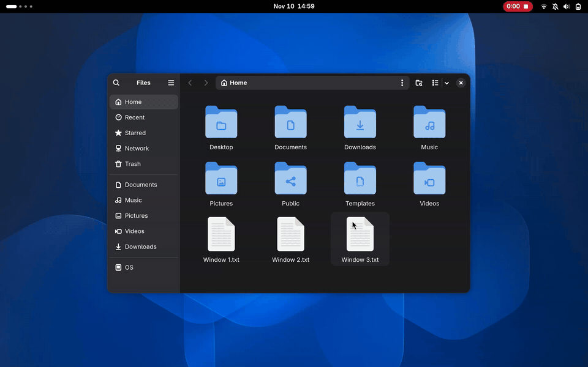

<h1 align="center">Drag to Workspace</h1>

<p align="center">
  
  <a href="https://github.com/aahil-khan/drag-to-workspace/releases/latest"></a>
  <a href="LICENSE"></a>
</p>

<p align="center">Move windows to other workspaces by dragging them to the edge of the screen, without opening the overview.</p>

<p align="center"></p>

## Features

| While dragging a window | What happens |
| --- | --- |
| Drop it at the left or right edge | It moves to the next workspace on that side. You stay where you are. |
| Hold it at the edge | A picker opens with every workspace on that side. Move up or down and drop. |
| Hold it at the top edge | A picker opens with every workspace, on both sides. Move sideways and drop. |
| Hold it at an edge between two monitors | The picker opens there, without crossing to the other monitor. |
| Drop on the inner half of a workspace in the picker, away from the screen edge | Goes with the window. The outer half, next to the edge, just sends it. Each half is labelled. |
| Press 1 to 9 | Chooses that workspace, then drop anywhere. Press it again to cancel. |
| Hold Ctrl as you drop | Goes with the window straight away. |
| Hold Alt as you drop | Moves all of that app's windows on this workspace too. |
| Right-click | Moves the window right away, and takes you with it when you let go. |
| Drag back away from the edge, or press Escape | Nothing moves. |

After a move, a small popup can say where the window went, with **Undo** and **Go** buttons. It's off by default: turn it on under **After a Move** in Look & Feel, where you can also choose how long it stays, which buttons it has, and where it appears.

The window keeps its position and size on the new workspace, and stays maximized if it was maximized.

A window can't be moved while it's fullscreen or set to appear on all workspaces, or if its app is on your excluded list. Resizing a window into the edge does nothing.

It works with touchscreens too, using the same gestures with your finger. The keys and right-click need a keyboard and mouse.

## Supported GNOME versions

| GNOME | Download |
| --- | --- |
| 49, 50, 51 | `drag-to-workspace-gnome-49-51.zip` |
| 47, 48 | `drag-to-workspace-gnome-47-48.zip` |
| 46 | `drag-to-workspace-gnome-46.zip` |

Check yours with `gnome-shell --version`. Each version was tested on real distro builds, including Ubuntu 24.04 and 26.04, Debian 13, Fedora 41 to 45, and AlmaLinux 10.

## Installation

### From a release

1. Download the zip for your GNOME version from the [latest release](https://github.com/aahil-khan/drag-to-workspace/releases/latest).
2. Install it:

   ```sh
   gnome-extensions install --force drag-to-workspace-gnome-49-51.zip
   ```

3. Log out and back in, as GNOME only finds new extensions at login.
4. Turn it on:

   ```sh
   gnome-extensions enable drag-to-workspace@aahil-khan.github.com
   ```

### From source

```sh
git clone https://github.com/aahil-khan/drag-to-workspace.git
cd drag-to-workspace
make install
```

This links the checkout into your extensions folder for GNOME 49 or newer. On older versions, install the zip that `make pack` builds into `dist/` instead. Then log out, log back in, and enable it as above.

## Window tiling

Dropping a window on a side of the screen normally tiles it to half the screen. Drag to Workspace only uses part of each edge, the top two thirds by default, and normal tiling keeps working everywhere else. A thin bar shows the zone as a window gets close.

You can resize or move the zones in the settings, or use only one edge. Another way to share an edge is to lower **Distance from Edge**: windows then tile near the edge and move when pushed right up to it.

The top edge and the edges between monitors are used all the time for maximizing and crossing, so they only open a picker after a longer hold, and a drop only moves the window once you've moved the pointer onto a workspace. Drop without choosing, and GNOME does what it normally would.

## Multiple monitors

Windows cross between monitors as usual. To use the workspace picker at the edge between two monitors, hold there. A window goes back to its original monitor when it moves.

If workspaces are set to the primary display only, windows on other displays are already on every workspace, so they can't be moved.

## Settings

Open them from the Extensions app, or run:

```sh
gnome-extensions prefs drag-to-workspace@aahil-khan.github.com
```

- **Zones:** where on each edge windows move, how close the pointer has to be, which monitors are used, and the hold-only edges.
- **Behaviour:** whether a drop keeps you on the current workspace, the ways to do the opposite, including which half of a workspace does it and how big it is, or holding over a workspace instead, number keys, and the key for moving all of an app's windows.
- **Look & Feel:** how long to hold before the picker opens, the timings for holding over a workspace, plus preview size, workspace names, app icons, the zone highlight, animation, and the popup after a move.
- **Apps:** apps whose windows are never moved.

## Limitations

- With vertical workspace layouts, the left edge moves windows up and the right edge moves them down.
- Grids of workspaces are treated as one long row.

## Translations

Translations are welcome. Start from `po/drag-to-workspace.pot`, save it as `po/<language>.po`, and open a pull request.

## Development

```sh
make test     # the drag logic, under node
make e2e      # real drags in a sandboxed headless GNOME Shell, on your own version
make install  # symlinks this checkout into your extensions folder
make pack     # builds the zips for extensions.gnome.org into dist/
make matrix   # tests each zip on the distros it targets, in containers with podman
make pot      # regenerates the translation template, po/drag-to-workspace.pot
```

`make e2e` runs a throwaway `gnome-shell --headless` with its own home, dconf and session bus, so it doesn't touch your running desktop. A driver extension moves a virtual pointer over real GTK4 windows and checks the results through Mutter. Any JS error in the shell log fails the run. Screenshots and logs land in `test/e2e/out/`.

### Layout

- `lib/logic.js` makes the decisions and has no GNOME imports.
- `extension.js` connects it to the shell.
- `lib/ui.js` draws during a drag, with `lib/workspaceCard.js` for each workspace and `lib/movedPopup.js` for the popup afterwards.
- `prefs.js` is the settings window, and the files in `prefs/` are its parts.

`make pack` compiles any translations in `po/` into the zips.

### Versions

There's no version checking at runtime. Each range of versions gets its own zip, built by `scripts/pack.sh`, with only the code that range runs:

| Zip | Versions | Differs by |
| --- | --- | --- |
| `drag-to-workspace-gnome-49-51.zip` | 49, 50, 51 | This checkout as it is |
| `drag-to-workspace-gnome-47-48.zip` | 47, 48 | `compat/pre49`, the older maximize API |
| `drag-to-workspace-gnome-46.zip` | 46 | Also `compat/46`, as there's no accent colour |

## License

GPL-2.0-or-later. See [LICENSE](LICENSE).
